# Parc d'hyperviseurs et répartition réseau

## Ce qu'est un hyperviseur KVM dans notre infrastructure

Un hyperviseur de type 1 (ou intégré au noyau Linux comme KVM, Kernel-based Virtual Machine) transforme un serveur physique en hôte capable d'exécuter plusieurs machines virtuelles isolées. Chaque machine virtuelle possède son propre noyau système, sa mémoire dédiée, ses disques virtuels et ses cartes réseau virtuelles raccordées aux ponts Ethernet de l'hôte.

Dans le contexte universitaire de la salle U3-316, l'équipe CaaScad n'administre pas directement les serveurs physiques ni les commutateurs Cisco Nexus. L'université gère les machines hôtes sur le réseau d'infrastructure VLAN 3 (`infra.stri`) et met à disposition des machines virtuelles QEMU/KVM pilotées par `libvirt`, sur lesquelles CaaScad déploie et exploite l'ensemble de sa plateforme.

## Contraintes matérielles et organisation du parc

Trois contraintes physiques encadrent l'architecture :

1. La virtualisation imbriquée (VT-x / AMD-V dans les VMs) est désactivée par l'exploitant matériel sur les hôtes KVM. Cela interdit d'exécuter un hyperviseur dans une VM ou des conteneurs isolés par micro-VM comme Kata Containers. CaaScad fournit donc uniquement une offre de conteneurs managés (CaaS).
2. Les quatre serveurs physiques retenus embarquent de 96 à 128 cœurs CPU, 384 Go de RAM et des liaisons réseau à 10 Gbps vers le cœur de commutation Nexus/NetApp. Ce débit suffit à faire transiter la réplication synchrone du stockage Longhorn V2 et le trafic réseau sans ajouter de carte dédiée.
3. Les autres serveurs disponibles dans la salle ne conviennent pas à la production : `mallory`, `trudy` et `craig` ont moins de CPU/RAM (ou pas de ports Nexus/NetApp), et le serveur `Proxmox VE` s'est révélé hors du domaine L2 du switch lors du PoC initial. Il reste donc vide en réserve (0 VM).

[Ouvrir le schéma interactif](schemas/01-parc-hyperviseurs-vms.html)

## Répartition des serveurs physiques et des 21 VMs

Le tableau ci-dessous recense les serveurs physiques du parc `infra.stri` :

| Nom DNS | VLAN 3 (IPv4 / IPv6) | VLAN dédié hôte | CPU / RAM | Ports Nexus / NetApp | Rôle CaaScad |
|---|---|---|---|---|---|
| `alice.infra.stri` | `172.16.0.1/23` / `2001:678:3fc:3::1/64` | 20 (`198.18.20.1/22` / `...:14::1/64`) | 128 / 384 Go | Oui | Actif (5 VMs) |
| `bob.infra.stri` | `172.16.0.5/23` / `2001:678:3fc:3::5/64` | 28 (`198.18.28.1/22` / `...:1c::1/64`) | 128 / 384 Go | Oui | Actif (5 VMs) |
| `eve.infra.stri` | `172.16.0.6/23` / `2001:678:3fc:3::6/64` | 52 (`198.18.52.1/22` / `...:34::1/64`) | 96 / 384 Go | Oui | Actif (5 VMs) |
| `oscar.infra.stri` | `172.16.0.7/23` / `2001:678:3fc:3::7/64` | 60 (`198.18.60.1/22` / `...:3c::1/64`) | 96 / 384 Go | Oui | Actif (6 VMs) |
| `Proxmox VE` | Hors domaine L2 du switch | Aucun | Non utilisé | Non utilisé | Réserve (0 VM) |
| `mallory` / `trudy` / `craig` | `172.16.0.8` / `.4` / `.9` | 36 / 44 / 68 | 16..32 / 64..288 Go | Non / Non / Oui | Hors périmètre |

Pour éviter qu'une panne d'un seul serveur physique n'interrompe un service critique, le placement des VMs respecte des règles d'anti-affinité strictes. Le HLD mentionnait 19 VMs ; le LLD aligné porte le total à 21 VMs (104 vCPU et 196 Go de RAM au total, soit moins de 15 % des ressources physiques disponibles) en ajoutant `nat-gw` pour la sortie campus et en séparant le runner CI du runner d'infrastructure.

| Hôte KVM | Pare-feux et Infra | Cluster Interne (6 VMs) | Cluster Client (7 VMs) | Charge allouée |
|---|---|---|---|---|
| `alice` | `fw1` (OPNsense), `pki-root` | `int-m1` | `cli-m1`, `cli-hci1` | 26 vCPU / 38 Go RAM |
| `bob` | `fw2` (OPNsense), `backup` | `int-m2`, `int-hci1` | `cli-hci2` | 28 vCPU / 52 Go RAM |
| `oscar` | `bastion`, `runner-ci` | `int-m3`, `int-hci2` | `cli-m2`, `cli-hci3` | 28 vCPU / 56 Go RAM |
| `eve` | `nat-gw`, `runner-infra` | `int-hci3` | `cli-m3`, `cli-hci4` | 26 vCPU / 50 Go RAM |

Ce placement assure trois garanties en cas de perte complète d'un hyperviseur :

1. La paire OPNsense (`fw1` sur Alice, `fw2` sur Bob) survit à la perte d'Alice ou de Bob grâce à CARP et `pfsync`.
2. Les trois masters `etcd` de chaque cluster sont sur trois hôtes distincts (Alice, Bob, Oscar pour l'Interne ; Alice, Oscar, Eve pour le Client). Aucun cluster ne perd son quorum sur une panne matérielle simple.
3. Les nœuds de stockage HCI sont eux aussi étalés sur trois hôtes différents côté Interne et sur les quatre hôtes côté Client, permettant de maintenir deux réplicas Longhorn V2 disponibles à tout moment.

Seules les deux passerelles d'accès (`bastion` sur Oscar et `nat-gw` sur Eve) ainsi que `backup` (sur Bob) sont uniques. Une défaillance d'Oscar ou d'Eve impose donc de redéployer la VM manquante par Ansible sur l'un des hyperviseurs survivants.

## Articulation réseau des hyperviseurs avec les VLANs CaaScad

Côté commutateur Cisco Nexus, les quatre hyperviseurs actifs reçoivent en trunk 802.1Q l'ensemble des VLANs dédiés au projet (VLANs 758 à 791), en plus de leur VLAN campus respectif (par exemple le VLAN 52 sur Eve, utilisé directement par l'interface externe `eth0` de la VM `nat-gw`). Chaque VM possède ainsi deux types d'attachements virtuels :

- Une interface de service (`eth0`) raccordée au pont du VLAN métier ou du cluster correspondant (VLAN 770 pour les nœuds internes, VLAN 769 pour les nœuds clients, VLAN 760 à 763 pour les VMs d'infrastructure, ou trunk 758..780 sur `fw1` et `fw2`), avec la VIP CARP d'OPNsense comme passerelle par défaut.
- Une interface d'administration hors bande (`eth1`) sur le VLAN 790 OOB (pour toutes les VMs sauf `runner-ci`, volontairement isolé de l'OOB), configurée sans passerelle par défaut pour empêcher tout routage de trafic applicatif par ce réseau L2.
