# ArgoCD et chaîne GitOps

## Ce qu'est ArgoCD

ArgoCD est un outil de déploiement continu conçu pour Kubernetes selon le modèle GitOps. Le principe est simple : un dépôt Git contient l'ensemble des manifests YAML décrivant l'état désiré des applications, et ArgoCD se charge en permanence d'aligner l'état réel des clusters Kubernetes sur ce dépôt.

Contrairement à une chaîne CI/CD classique dite « Push » (où un pipeline externe pousse des commandes `kubectl apply` vers l'API du cluster avec des identifiants d'administrateur), ArgoCD fonctionne en mode « Pull ». Il tourne à l'intérieur de l'infrastructure protégée et vient lui-même lire les dépôts Git autorisés pour appliquer les changements.

## Comment fonctionne ArgoCD

ArgoCD regroupe trois composants principaux :

1. Le `repo-server` clone les dépôts Git, rend les manifests YAML (bruts, Helm ou Kustomize) et met en cache le résultat.
2. L'`application-controller` compare en continu l'état souhaité fourni par le `repo-server` avec l'état vivant dans Kubernetes (via l'API Server). Dès qu'un écart apparaît (« OutOfSync »), qu'il s'agisse d'un nouveau commit ou d'une modification manuelle non voulue sur le cluster, il corrige automatiquement le cluster.
3. L'`api-server` expose l'interface web, l'API REST/gRPC et gère les webhooks Git qui permettent d'accélérer la synchronisation sans attendre la scrutation périodique (par défaut toutes les trois minutes).

## Articulation dans le projet CaaScad

Dans CaaScad, ArgoCD permet de séparer hermétiquement l'interface exposée aux clients (Site Manager) du réseau d'administration OOB et de l'API du Cluster Client.

[Ouvrir le schéma interactif](schemas/06-chaine-gitops-argocd.html)

### Emplacement et accès réseau d'ArgoCD

ArgoCD tourne sur le Cluster Interne dans le namespace `gitops` (2 réplicas stateless pour `server`, `repo-server` et `controller`). Son interface interne est accessible aux équipes via l'Ingress privé sur `https://argocd.caascad.internal` (`2001:678:3fc:bb21::1`).

Pour piloter le Cluster Client tout en gardant le trafic d'administration hors du réseau client, les pods d'ArgoCD reçoivent une seconde carte réseau virtuelle injectée par Multus (`macvlan` sur le VLAN 790 OOB) portant l'IP `fd07:63fe:c5dd:1:5::3`. ArgoCD se connecte ainsi à l'API du Cluster Client via la VIP OOB `https://[fd07:63fe:c5dd:1:2::10]:6443`, avec un `ServiceAccount` dédié et une règle explicite dans `nftables` (`oob_guard`).

### Déroulement du déploiement d'une application client

Quand un client déploie ou modifie un conteneur depuis le portail web, la chaîne suit un chemin balisé en quatre étapes :

1. Le client valide son formulaire sur Site Manager (namespace `portal-apps`, Cluster Interne). Site Manager vérifie ses droits dans MariaDB, contrôle le gabarit de quota (Starter, Standard ou Pro) et vérifie que l'image choisie figure dans le catalogue autorisé.
2. Site Manager n'a aucune interface Multus OOB et ne peut pas parler à l'API du Cluster Client. À la place, il écrit les manifests YAML du client (Namespace, Pod Security Standards, `CiliumNetworkPolicy`, `ResourceQuota`, Deployment, Service) dans le répertoire `tenants/tenant-<client>/` sur la forge du campus (`gitlab.inetdoc.net`), à l'aide d'un jeton API GitLab stocké dans OpenBao et injecté par External Secrets Operator.
3. ArgoCD détecte le nouveau commit sur `gitlab.inetdoc.net` (sous 3 minutes en scrutation, ou aussitôt par webhook) et applique ces manifests sur le Cluster Client à travers son interface OOB `1:5::3`.
4. En parallèle, Site Manager appelle l'API Cloudflare (flux `F25`) pour publier la route HTTPS du client vers la VIP Envoy du Cluster Client (`2001:678:3fc:bb24::1`), et affiche ensuite l'état des conteneurs en interrogeant VictoriaMetrics ou l'API interne d'ArgoCD.

### Rôle distinct des deux GitLab Runners

L'automatisation CI/CD hors Kubernetes s'appuie sur deux machines virtuelles dédiées dans le VLAN 763 (`SRV_RUNNERS`), elles aussi cloisonnées selon leur niveau de privilège :

| VM Runner | Hôte KVM | Adresses IP | Rôle et périmètre |
|---|---|---|---|
| `runner-ci` | `oscar` | `2001:678:3fc:bb43::2` (sans OOB) | Exécute les jobs `ci`, `build`, `lint` sur Merge Requests et pousse les images vers la registry. |
| `runner-infra` | `eve` | `2001:678:3fc:bb43::1` + OOB `1:4::3` | Exécute Ansible et OpenTofu sur les VMs via le VLAN 790 OOB, uniquement depuis la branche protégée `main`. |

De cette façon, une Merge Request applicative ou un job de build compromis sur `runner-ci` n'a aucun accès réseau au plan d'administration OOB.
