# La stack de logs (Fluent Bit, VictoriaLogs et Grafana)

## Ce qu'est une stack de journalisation centralisée

Sur une plateforme distribuée comptant 21 VMs, 2 pare-feux, des dizaines de pods système et des conteneurs clients, consulter les journaux serveur par serveur avec `journalctl` ou `kubectl logs` devient vite impraticable, surtout si une machine tombe ou redémarre.

Une stack de journalisation centralisée rassemble automatiquement trois fonctions : la collecte sur chaque source, l'expédition vers un puits unique indexé pour la recherche, et la visualisation accompagnée de règles d'alerte.

## Comment fonctionne notre stack par rapport aux alternatives

CaaScad a retenu le couple Fluent Bit et VictoriaLogs (associé à VictoriaMetrics pour les métriques) plutôt que des piles plus lourdes comme Elasticsearch/Logstash/Kibana (ELK) ou Prometheus/Loki/Promtail. Le choix vient du bilan mémoire constaté lors de la conception : VictoriaMetrics et VictoriaLogs consomment nettement moins de RAM pour absorber simultanément les logs des deux clusters Kubernetes, des VMs Ubuntu et des équipements réseau.

Le pipeline repose sur trois étages simples :

- Des agents légers (`Fluent Bit` en C, faible empreinte mémoire) lisent en continu les fichiers de logs locaux ou les journaux des conteneurs CRI, les structurent en JSON et les poussent par lots en HTTP vers un collecteur central.
- `VictoriaLogs` stocke et indexe ces flux structurés sur disque avec compression et permet des requêtes rapides par champs (`namespace`, `host`, `level`, `msg`) via le langage LogsQL.
- `Grafana` interroge VictoriaLogs comme datasource pour afficher les journaux et évaluer chaque minute des règles d'alerte envoyées par SMTP ou webhook en moins de cinq minutes.

## Articulation dans le projet CaaScad

Dans CaaScad, toute la collecte de journaux et de métriques emprunte exclusivement le réseau d'administration hors bande (VLAN 790 OOB, `fd07:63fe:c5dd:1::/64`). Les applications exposées aux clients et les flux sur les VLANs de production ne voient donc jamais le trafic de supervision.

[Ouvrir le schéma interactif](schemas/07-stack-logs-victoria.html)

### Les quatre sources collectées vers VictoriaLogs

Le StatefulSet `victorialogs` tourne dans le namespace `observability` du Cluster Interne avec un volume persistant Longhorn V2 de 60 Go et une rétention locale fixée à 90 jours à chaud (`-retentionPeriod=90d`). Grâce à une interface réseau Multus `macvlan` attachée sur le VLAN 790 (`fd07:63fe:c5dd:1:5::2`), il reçoit quatre flux distincts :

| Source | Agent / Méthode d'envoi | Contenu collecté | Port / Protocole |
|---|---|---|---|
| Conteneurs Interne & Client | DaemonSet `fluent-bit` | Journaux CRI JSON (`/var/log/containers/*.log`) | HTTP JSON sur `1:5::2:9428` |
| VMs Ubuntu & Bastion | Agent `fluent-bit` hôte | `/var/log/auth.log`, `/var/log/sudo.log`, noyaux `OOB-DROP: `, logs Guacamole | HTTP JSON sur `1:5::2:9428` |
| Pare-feux OPNsense (`fw1`, `fw2`) | Export Syslog distant | Rejets `Default Drop`, bascules CARP/FRR, alertes IDS Suricata (EVE JSON) | UDP/TCP 514 vers `1:5::2` |
| Réseau eBPF Cilium / Hubble | Événements Hubble | Refus de paquets (`drops`) et violations de `CiliumNetworkPolicy` sur `tenant-<client>` | HTTP JSON via cluster |

Sur les 19 VMs Ubuntu, le jeu de règles `nftables` (`oob_guard`) autorise explicitement les paquets vers l'adresse `1:5::2` sur le port 9428, tout en journalisant avec le préfixe `OOB-DROP: ` toute tentative de connexion illégitime vers le VLAN 790.

### Exploitation dans Grafana et détection d'incidents

Grafana tourne en 2 réplicas dans le namespace `observability` (exposé en interne via Envoy sur `https://grafana.caascad.internal` à l'adresse `2001:678:3fc:bb21::1`) avec authentification OpenLDAP. Il relie les journaux VictoriaLogs et les métriques VictoriaMetrics (conservées 6 mois sur un volume de 50 Go et collectées par `vmagent` depuis l'IP Multus `1:5::1`).

Pour le multi-tenant, les administrateurs de CaaScad voient l'ensemble des journaux système, pare-feu et conteneurs dans l'organisation principale, tandis que les clients consultent uniquement une organisation Grafana dédiée (ou des vues intégrées à Site Manager) filtrée par un label fixe `namespace="tenant-<client>"`. Ils peuvent ainsi lire les sorties de leurs propres conteneurs sans jamais voir les journaux d'un autre client ni ceux de l'infrastructure.

Côté sécurité, Grafana Alerting évalue trois signaux liés directement aux journaux toutes les minutes :

- Tout événement `OOB-DROP` dans les logs noyau ou toute ouverture de session PAM sur le compte d'urgence `breakglass` génère une alerte critique immédiate.
- Un pic anormal de paquets bloqués par Hubble entre namespaces déclenche une alerte d'avertissement pour détecter une tentative de balayage réseau depuis un conteneur client.
