# Architecture réseau et plan d'adressage IPv6

## Rappel sur le fonctionnement d'IPv6

Une adresse IPv6 fait **128 bits** (contre 32 bits en IPv4). Elle s'écrit sous forme de **8 blocs de 16 bits en hexadécimal** séparés par des deux-points (`:`). Chaque caractère hexadécimal représente 4 bits, donc chaque bloc contient 4 caractères.

Exemple : `2001:0678:03fc:bb20:0000:0000:0000:0001`.

Pour éviter d'écrire des suites de zéros interminables, deux règles de simplification s'appliquent :

1. Les zéros au début de chaque bloc s'effacent (`0678` devient `678`, `0000` devient `0`, `0001` devient `1`).
2. Une seule suite de blocs égaux à `0` consécutifs peut être remplacée par `::`. L'adresse précédente s'écrit donc `2001:678:3fc:bb20::1`. On ne peut utiliser `::` qu'une seule fois par adresse pour garder le compte des 8 blocs sans ambiguïté.

### Lire les masques (préfixes) en IPv6

Comme en IPv4, le slash `/N` indique combien de bits à gauche identifient le réseau (le préfixe), le reste servant à numéroter les machines :

| Masque | Portion de l'adresse figée | Taille disponible dans notre plan | Usage courant |
|---|---|---|---|
| `/48` | Les 3 premiers blocs (`fd07:63fe:c5dd`) | 65 536 sous-réseaux `/64` | Préfixe d'un site ou domaine privé complet. |
| `/56` | Les 3 premiers blocs + 2 premiers caractères du 4e (`2001:678:3fc:bb`) | 256 sous-réseaux `/64` (`bb00` à `bbff`) | Délégation attribuée à CaaScad pour les réseaux routés. |
| `/60` | 3 blocs + 3 premiers caractères du 4e (`2001:678:3fc:bb0` ou `bb1`) | 16 sous-réseaux `/64` (`bb00`..`bb0f`, `bb10`..`bb1f`) | Pool attribué à un cluster Kubernetes (1 `/64` par nœud). |
| `/64` | Les 4 premiers blocs complets (64 bits réseau, 64 bits hôte) | 18 milliards de milliards d'adresses | Taille standard obligatoire d'un VLAN ou réseau local IPv6. |
| `/112` | 7 blocs complets (`fd07:63fe:c5dd:101::/112`) | 65 536 adresses | Pool interne `Service CIDR` (`ClusterIP`) dans Kubernetes. |
| `/128` | Les 128 bits complets | 1 seule adresse IP | Adresse d'une machine ou d'une VIP annoncée seule en BGP. |

### Préfixe routé (GUA), préfixe privé (ULA) et autres plages spéciales

En IPv6, on ne fait pas du NAT partout comme avec `192.168.0.0/16` en IPv4. On distingue trois familles d'adresses par leur début :

- Les adresses GUA (Global Unicast Address, `2000::/3`, commençant par `2` ou `3`) sont publiques et routables sur Internet ou dans l'infrastructure universitaire. Dans notre projet, le bloc `2001:678:3fc:bb00::/56` est un préfixe routé GUA. Chaque machine, chaque VM et même chaque pod porte une adresse issue de ce bloc.
- Les adresses ULA (Unique Local Address, `fc00::/7`, en pratique `fd00::/8`, commençant par `fd`) sont l'équivalent des plages privées IPv4 (`10.0.0.0/8`, `192.168.0.0/16`). Elles ne doivent jamais être routées sur Internet. Nous utilisons `fd07:63fe:c5dd::/48` pour le réseau d'administration hors bande (OOB), le lien de synchronisation des pare-feux et les `ClusterIP` internes de Kubernetes.
- Les adresses Link-Local (`fe80::/10`) sont auto-générées sur chaque interface réseau et ne sortent jamais du VLAN (jamais routées). Elles servent aux échanges locaux comme le protocole NDP (Neighbor Discovery Protocol), qui remplace ARP en IPv4, ainsi qu'aux annonces de routeurs (RA, Router Advertisement).
- Le préfixe NAT64 (`64:ff9b::/96`, normalisé par la RFC 6052) encapsule une adresse IPv4 dans les 32 derniers bits d'une adresse IPv6 pour permettre à un réseau IPv6-only de joindre des serveurs IPv4 externes.

[Ouvrir le schéma interactif](schemas/02-decoupage-ipv6.html)

## Articulation des préfixes avec les VLANs et le routage CaaScad

L'architecture réseau est entièrement **IPv6-only** dans les VLANs internes (758 à 791). Un seul petit réseau IPv4 privé (`10.254.0.0/29`) existe sur le VLAN 780 uniquement pour assurer la traduction NAT64 vers la sortie campus.

[Ouvrir le schéma interactif](schemas/03-topologie-reseau-flux.html)

### Plan complet des VLANs et des préfixes

Sur chaque VLAN routé par la paire OPNsense (`fw1` et `fw2`), la convention d'adressage est fixe : l'adresse virtuelle CARP (passerelle des machines) se termine par `:ffff:ffff:ffff:ffff`, `fw1` porte `:fffe` et `fw2` porte `:fffd`. Les VHID CARP vont de 10 à 18 (`advskew 0` sur `fw1`, `100` sur `fw2`).

| VLAN | Nom / Zone | Préfixe IPv6 (ou IPv4) | Passerelle et adresses principales | Attribution et usage |
|---|---|---|---|---|
| 780 | `WAN_TRANSIT` | `2001:678:3fc:bbff::/64` + `10.254.0.0/29` | VIP `:ffff` / `.6` (VHID 10) ; `nat-gw ::1` / `.1` | Transit entre OPNsense HA et `nat-gw` vers le campus. |
| 791 | `FW_HA_SYNC` | `fd07:63fe:c5dd:2::/64` (ULA) | `fw1 ::1`, `fw2 ::2` | Lien point-à-point dédié à `pfsync`, CARP (proto 112) et XMLRPC. |
| 790 | `OOB_MGMT` | `fd07:63fe:c5dd:1::/64` (ULA) | Pas de passerelle (L2 pur) | Administration SSH/HTTPS, API K8s `1:1::10` et `1:2::10`, collecte logs/métriques. |
| 770 | `K8S_INT_NODES` | `2001:678:3fc:bb20::/64` (GUA) | VIP `:ffff` (VHID 11) ; nœuds `::1..6` ; API `::10` | VMs du Cluster Interne RKE2 (masters et HCI). |
| BGP | `K8S_INT_PODS` | `2001:678:3fc:bb00::/60` (GUA) | 1 `/64` par nœud (AS 65001) | Adresses routées des pods du Cluster Interne (bloquées en entrée WAN). |
| BGP | `K8S_INT_LB_PRIV` | `2001:678:3fc:bb21::/64` (GUA) | `::1` Envoy privé, `::2` LDAP, `::3` CUPS | Services internes non exposés sur Internet. |
| BGP | `K8S_INT_LB_PUB` | `2001:678:3fc:bb22::/64` (GUA) | `::1` Envoy public | Site Vitrine et Site Manager exposés via tunnel Cloudflare. |
| 769 | `K8S_CLI_NODES` | `2001:678:3fc:bb23::/64` (GUA) | VIP `:ffff` (VHID 12) ; nœuds `::1..7` ; API `::10` | VMs du Cluster Client RKE2 (masters et HCI). |
| BGP | `K8S_CLI_PODS` | `2001:678:3fc:bb10::/60` (GUA) | 1 `/64` par nœud (AS 65002) | Adresses des pods clients (isolées du Cluster Interne par `F17`). |
| BGP | `K8S_CLI_LB` | `2001:678:3fc:bb24::/64` (GUA) | `::1` Envoy client, `::100+` L4 campus | Exposition des applications clientes. |
| 759 | `LAN_USER` | `2001:678:3fc:bb30::/64` (GUA) | VIP `:ffff` (VHID 13) ; plage `::1000..1fff` | Postes des employés en Classe 308 (RA + DHCPv6 stateful/RDNSS). |
| 758 | `LAN_COPIEUR` | `2001:678:3fc:bb31::/64` (GUA) | VIP `:ffff` (VHID 14) ; plage `::10..ff` | Imprimantes et copieurs Classe 308 (DHCPv6 réservations statiques). |
| 760 | `SRV_BASTION` | `2001:678:3fc:bb40::/64` (GUA) | `bastion ::1`, VIP `:ffff` (VHID 15) | Bastion Guacamole et connecteur `cloudflared`. |
| 761 | `SRV_PKI_ROOT` | `2001:678:3fc:bb41::/64` (GUA) | `pki-root ::1`, VIP `:ffff` (VHID 16) | Root CA hors ligne (isolée par `F28`, allumée uniquement en cérémonie). |
| 762 | `SRV_BACKUP` | `2001:678:3fc:bb42::/64` (GUA) | `backup ::1`, VIP `:ffff` (VHID 17) | Serveur BorgBackup local (export vers Hetzner). |
| 763 | `SRV_RUNNERS` | `2001:678:3fc:bb43::/64` (GUA) | `runner-infra ::1`, `runner-ci ::2` (VHID 18) | Exécuteurs CI/CD GitLab. |

Note d'alignement : le LLD corrige une inversion présente sur d'anciens schémas entre `bb30` et `bb31` (`759 LAN_USER = bb30::/64` et `758 LAN_COPIEUR = bb31::/64`). Les postes utilisateurs ne joignent jamais directement les imprimantes (`F20 DENY`) : ils impriment via `CUPS` (`bb21::3`) qui relaie vers le VLAN 758 (`F21 ALLOW`), tandis que les copieurs n'initient aucun flux sortant (`F22 DENY`).

### Comment les paquets entrent et sortent malgré les restrictions du campus

Le pare-feu de l'université impose deux limites : nous ne pouvons pas injecter la route de `2001:678:3fc:bb00::/56` dans le routeur du campus, et le trafic entrant depuis Internet est bloqué (hors TCP 2222 IPv6). CaaScad résout ce blocage en deux points complémentaires.

En sortie vers Internet, la VM `nat-gw` (sur Eve) relie le VLAN 52 campus (adressage SLAAC/DHCP campus) au VLAN 780 de transit OPNsense. Elle possède une route statique renvoyant `2001:678:3fc:bb00::/56` vers la VIP OPNsense `bbff::ffff`, et applique du masquerading (SNAT) via `nftables` sur l'interface VLAN 52 pour `bb00::/56` (IPv6) et `10.254.0.0/29` (IPv4 issu de Tayga NAT64). Les machines du campus voient donc le trafic sortir depuis l'adresse obtenue par `nat-gw` sur le VLAN 52. Pour joindre des serveurs externes IPv4-only, Unbound active DNS64 (`64:ff9b::/96`) et OPNsense active Tayga NAT64, qui traduit les paquets destinés à `64:ff9b::/96` vers `10.254.0.0/29` avant qu'ils ne traversent `nat-gw`.

En entrée depuis Internet, `cloudflared` (sur `bastion`, VLAN 760) maintient un tunnel sortant permanent vers Cloudflare Edge (UDP/TCP 7844 et TCP 443) au lieu d'ouvrir des ports sur le pare-feu campus. Il redirige ensuite localement les requêtes publiques selon le nom d'hôte vers Guacamole (`127.0.0.1:8080`), Site Vitrine/Manager (`bb22::1:443`) ou l'Ingress client (`bb24::1:443`).
