# Réseau Kubernetes : Cilium, Multus, eBGP avec FRR et Pools LB

## Ce que sont Cilium, Multus et BGP

Dans Kubernetes, le plugin CNI (Container Network Interface) attribue une adresse IP à chaque pod et permet aux pods de communiquer d'un nœud à l'autre. `Cilium` est un CNI moderne fondé sur **eBPF** (Extended Berkeley Packet Filter), une technologie qui exécute des programmes réseau directement dans le noyau Linux sans passer par de longues chaînes de règles `iptables`.

`Multus` est un « méta-CNI » : il vient en complément du CNI principal (Cilium) pour attacher une seconde interface réseau à certains pods précis qui ont besoin d'appartenir à un autre VLAN physique.

`BGP` (Border Gateway Protocol) est le protocole de routage dynamique qui permet à deux équipements réseau (ici les nœuds Kubernetes et les pare-feux OPNsense) d'échanger leurs tables de routes sur TCP port 179. Lorsqu'on parle d'**eBGP** (External BGP), cela signifie simplement que les deux pairs appartiennent à des numéros de système autonome (**AS**) différents.

## Comment fonctionnent Cilium, Multus et le peering eBGP

### Pourquoi BGP devient indispensable (et pourquoi MetalLB L2 ne suffit pas)

Dans notre plan IPv6, les nœuds du Cluster Client vivent sur le VLAN 769 dans le préfixe `2001:678:3fc:bb23::/64`. Mais les adresses des pods viennent d'un autre préfixe (`bb10::/60`) et les adresses LoadBalancer des services clients viennent d'un troisième préfixe (`bb24::/64`).

Dans un réseau local Ethernet, le protocole NDP (l'équivalent d'ARP en IPv6) ne fonctionne que pour les adresses appartenant au même sous-réseau que le VLAN. Un pare-feu OPNsense sur le VLAN 769 ne peut donc pas deviner par NDP sur quel nœud Kubernetes se trouve l'IP de pod `bb10:0:0:2::4a` ou la VIP LoadBalancer `bb24::1`. Sans BGP, il faudrait soit enfermer les pods dans un tunnel VXLAN (qui ajoute de la latence et masque les vraies adresses IP), soit placer toutes les VIP LoadBalancer dans le même VLAN que les nœuds en mode L2 (ce qui interdit l'isolation par préfixe séparé).

Avec le **BGP Control Plane** intégré à Cilium et le démon **FRR** (Free Routing) actif sur OPNsense, chaque nœud Kubernetes devient un petit routeur qui annonce automatiquement au pare-feu :

- Le sous-réseau `/64` attribué à ses propres pods locaux (extrait du `/60` du cluster).
- Les adresses `/128` des services de type `LoadBalancer` actives sur le cluster.

### Fonctionnement détaillé de Cilium en Native Routing + WireGuard

Dans les deux clusters, Cilium 1.19 est déployé avec quatre options structurantes :

- `ipv4.enabled: false` et `ipv6.enabled: true` : pile 100 % IPv6.
- `routingMode: native` et `ipv6NativeRoutingCIDR: "2001:678:3fc:bb00::/56"` : aucune encapsulation VXLAN ou Geneve. Les paquets sortent directement avec l'adresse GUA réelle du pod, sans SNAT en interne, ce qui permet aux pare-feux OPNsense d'identifier exactement la source de chaque flux.
- `kubeProxyReplacement: true` : eBPF remplace intégralement `kube-proxy` pour répartir le trafic des `ClusterIP` (`fd07:63fe:c5dd:101::/112` et `102::/112`), des `NodePort` et des `LoadBalancer`.
- `encryption.enabled: true` (`type: wireguard`) : tout le trafic entre deux nœuds d'un même cluster est chiffré de manière transparente au niveau noyau par WireGuard (clés gérées automatiquement dans `cilium-secrets`).

[Ouvrir le schéma interactif](schemas/04-ebgp-cilium-frr.html)

## Articulation dans le projet CaaScad : eBGP, Pools LB et Multus

### Peering eBGP entre Cilium (AS 65001 / 65002) et FRR (AS 65000)

Sur OPNsense (`fw1` et `fw2`), FRR porte le système autonome privé **AS 65000** (`router-id 10.254.0.5` sur `fw1` et `10.254.0.4` sur `fw2`). Côté Kubernetes, le Cluster Interne porte **AS 65001** et le Cluster Client porte **AS 65002**.

Chaque nœud de chaque cluster monte simultanément **deux sessions eBGP sur TCP/179** (autorisées par la règle `F07`) vers les adresses physiques de `fw1` (`:fffe`) et `fw2` (`:fffd`) dans son VLAN, et non vers la VIP CARP. Cela permet à `fw2` d'avoir déjà toutes les routes en mémoire et de reprendre le routage en moins de 5 secondes si `fw1` tombe. Les timers BGP sont réglés à **3 secondes de keepalive et 9 secondes de hold**, ce qui accélère la détection de perte d'un nœud Kubernetes.

Pour empêcher qu'un nœud compromis n'annonce n'importe quel préfixe (par exemple un réseau Campus ou Internet), FRR applique une `prefix-list` stricte en entrée de chaque groupe de pairs :

- `PL-K8S-INT` (AS 65001) n'accepte que `bb00::/60` (découpé en `/64`), `bb21::/64` (jusqu'au `/128`) et `bb22::/64` (jusqu'au `/128`).
- `PL-K8S-CLI` (AS 65002) n'accepte que `bb10::/60` (découpé en `/64`) et `bb24::/64` (jusqu'au `/128`).

### Pools LoadBalancer (`CiliumLoadBalancerIPPool`) et Envoy

Cilium gère lui-même l'attribution d'adresses IP externes aux services Kubernetes de type `LoadBalancer` (sans avoir besoin de MetalLB) grâce aux objets `CiliumLoadBalancerIPPool`, puis les annonce par eBGP à FRR :

| Pool LoadBalancer | Préfixe | Cluster | Affectation principale |
|---|---|---|---|
| `K8S_INT_LB_PRIV` | `2001:678:3fc:bb21::/64` | Interne | `::1` Ingress Envoy privé (Grafana, NetBox, ArgoCD, OpenBao), `::2` OpenLDAP (`636`), `::3` CUPS (`631`). |
| `K8S_INT_LB_PUB` | `2001:678:3fc:bb22::/64` | Interne | `::1` Ingress Envoy public (Site Vitrine, Site Manager). |
| `K8S_CLI_LB` | `2001:678:3fc:bb24::/64` | Client | `::1` Ingress Envoy client (routage HTTP/HTTPS par en-tête `Host`), `::100+` services L4 dédiés campus. |

Dans le Cluster Interne, la séparation entre `bb21::/64` et `bb22::/64` permet à OPNsense de bloquer tout accès externe vers `bb21::/64` tout en exposant `bb22::/64` au tunnel Cloudflare et au réseau campus. Dans le Cluster Client, le HLD prévoit à terme d'allouer un sous-pool dédié par client dans `bb24::/64` afin d'éviter qu'une adresse IP libérée par un client ne soit réattribuée aussitôt à un autre.

### Multus pour l'accès ciblé au VLAN 790 OOB

Chaque VM de nœud Kubernetes porte deux cartes réseau : `eth0` sur le VLAN du cluster (770 ou 769) et `eth1` sur le VLAN 790 OOB (`fd07:63fe:c5dd:1::/64`). Multus utilise une `NetworkAttachmentDefinition` de type `macvlan` raccordée à `eth1` pour brancher une seconde interface uniquement sur trois workloads du Cluster Interne :

- `vmagent` (`fd07:63fe:c5dd:1:5::1`) pour collecter les métriques de toutes les machines sur le VLAN 790.
- `VictoriaLogs` (`fd07:63fe:c5dd:1:5::2`) pour recevoir Fluent Bit et le Syslog OPNsense.
- `ArgoCD` (`fd07:63fe:c5dd:1:5::3`) pour piloter l'API du Cluster Client (`1:2::10:6443`).

Aucun autre pod (ni du Cluster Interne, ni du Cluster Client) ne dispose d'interface Multus, et une `CiliumClusterwideHostPolicy` complétée par `nftables` (`oob_guard`) interdit aux pods standards de joindre le VLAN 790.
