# DNS Unbound et passerelle DNS64 / NAT64

## Ce qu'est Unbound

Unbound est un résolveur DNS récursif, validant (DNSSEC) et cache, développé par NLnet Labs. Dans l'architecture DNS, il joue un rôle distinct d'un serveur faisant autorité comme BIND9 ou NSD (d'ailleurs le LLD demande de remplacer les anciennes icônes BIND9 des schémas par Unbound). Unbound répond aux requêtes des postes utilisateurs et des serveurs en interrogeant les serveurs DNS publics sur Internet, met en cache les réponses, et héberge les enregistrements locaux du domaine interne de l'entreprise.

## Comment fonctionnent Unbound et le module DNS64

### Résolution locale et récursion

Lorsqu'une VM ou un poste de travail demande l'adresse d'un nom de domaine, trois cas se présentent :

1. **Zone locale statique (`local-data`)** : si le nom appartient au domaine interne (ici `caascad.internal`), Unbound répond immédiatement sans sortir sur Internet.
2. **Cache** : si un autre client a déjà demandé ce domaine externe récemment, Unbound renvoie la réponse mémorisée.
3. **Récursion / Forwarding amont** : sinon, Unbound interroge les serveurs DNS racines ou les résolveurs amont autorisés par le pare-feu (flux `F04`), vérifie éventuellement les signatures DNSSEC et retourne l'adresse au client.

### Le mécanisme DNS64 + NAT64 pour joindre l'IPv4

Dans un réseau IPv6-only comme celui de CaaScad, les pods et les VMs ne possèdent pas d'adresse IPv4 routée. Si un pod doit télécharger une image conteneur ou joindre une API externe qui n'a qu'un enregistrement IPv4 (`A`) et aucun enregistrement IPv6 (`AAAA`), la connexion échouerait sans traduction.

C'est là qu'intervient **DNS64** dans Unbound, couplé à **Tayga NAT64** sur OPNsense :

[Ouvrir le schéma interactif](schemas/05-dns64-nat64-unbound.html)

1. Le pod IPv6 demande l'enregistrement `AAAA` de la cible à CoreDNS, qui transmet à Unbound sur la VIP OPNsense du VLAN.
2. Unbound interroge Internet : la cible ne renvoie aucun `AAAA`, mais possède un enregistrement IPv4 `A` (par exemple `198.51.100.10`).
3. Grâce au module DNS64 configuré sur `64:ff9b::/96`, Unbound fabrique une fausse adresse IPv6 en collant l'IPv4 à la fin du préfixe `64:ff9b::` et la renvoie au pod.
4. Le pod ouvre sa connexion TCP/443 vers cette adresse `64:ff9b::...`. Le routeur OPNsense intercepte le préfixe `64:ff9b::/96`, confie le paquet à **Tayga**, qui le convertit en paquet IPv4 véritable avec comme source la VIP WAN `10.254.0.6` (VLAN 780) et l'envoie vers `nat-gw` (`10.254.0.1`), qui applique le SNAT sortant vers Internet.

## Articulation dans le projet CaaScad

Dans CaaScad, Unbound tourne nativement sur la paire de pare-feux OPNsense (`fw1` et `fw2`), en dehors des clusters Kubernetes. Ce choix évite toute dépendance circulaire lors d'un redémarrage complet de la salle U3-316 : même si les clusters RKE2 sont arrêtés, la résolution DNS de l'infrastructure et des postes de travail fonctionne déjà.

### Placement, haute disponibilité et distribution aux clients

Unbound écoute sur la VIP CARP (`:ffff:ffff:ffff:ffff`) de chaque VLAN routé, à l'exception du VLAN 761 (`SRV_PKI_ROOT`) qui reste isolé hors ligne. La configuration Unbound (entrées locales et activation DNS64) est répliquée automatiquement de `fw1` vers `fw2` par XMLRPC.

La façon dont les équipements apprennent l'adresse du résolveur diffère selon le type de réseau :

- Sur les 19 VMs Ubuntu, Ansible inscrit directement la VIP Unbound du VLAN dans `/etc/resolv.conf` avec le domaine de recherche `caascad.internal` (flux `F03` autorisant UDP/TCP 53).
- Sur les VLANs bureautiques Classe 308 (`759 LAN_USER` et `758 LAN_COPIEUR`), l'option `RDNSS` des annonces de routeur (RA) et DHCPv6 fournit automatiquement la VIP Unbound aux postes et copieurs.
- Dans les clusters Kubernetes, `CoreDNS` résout les noms internes `.cluster.local` des services Kubernetes et relaie tout le reste vers Unbound sur la VIP du VLAN 770 ou 769.

### Table des enregistrements locaux `caascad.internal`

Unbound sert les adresses suivantes pour les services internes et l'administration :

| Nom DNS (`caascad.internal`) | Adresse IPv6 résolue | Plan réseau et destination |
|---|---|---|
| `api.int.caascad.internal` | `fd07:63fe:c5dd:1:1::10` | OOB VLAN 790 : VIP API Cluster Interne (`kube-vip`). |
| `api.cli.caascad.internal` | `fd07:63fe:c5dd:1:2::10` | OOB VLAN 790 : VIP API Cluster Client (`kube-vip`). |
| `ldap.caascad.internal` | `2001:678:3fc:bb21::2` | LoadBalancer Interne privé : OpenLDAP (LDAPS 636). |
| `cups.caascad.internal` | `2001:678:3fc:bb21::3` | LoadBalancer Interne privé : serveur d'impression CUPS (631). |
| `grafana.caascad.internal` | `2001:678:3fc:bb21::1` | Ingress Envoy privé : Grafana (monitoring/logs). |
| `netbox.caascad.internal` | `2001:678:3fc:bb21::1` | Ingress Envoy privé : IPAM / inventaire NetBox. |
| `argocd.caascad.internal` | `2001:678:3fc:bb21::1` | Ingress Envoy privé : console GitOps ArgoCD. |
| `bao.caascad.internal` | `2001:678:3fc:bb21::1` | Ingress Envoy privé : coffre et PKI OpenBao. |
| `vitrine.caascad.internal` | `2001:678:3fc:bb22::1` | Ingress Envoy public : Site Vitrine. |
| `manager.caascad.internal` | `2001:678:3fc:bb22::1` | Ingress Envoy public : Site Manager. |
