# Cloisonnement réseau avec CiliumNetworkPolicy

## Ce qu'est une CiliumNetworkPolicy

Dans Kubernetes, tous les pods peuvent par défaut communiquer librement avec tous les autres pods du cluster, quel que soit leur namespace. Une `NetworkPolicy` permet de fermer ces flux et de n'autoriser que les échanges prévus.

Une `CiliumNetworkPolicy` (CNP) est la ressource personnalisée propre à Cilium. Elle va plus loin que la `NetworkPolicy` standard de Kubernetes :

- Elle est exécutée directement en **eBPF** dans le noyau Linux, sans générer des milliers de règles `iptables`.
- Elle identifie les pods par leur identité cryptographique/label Cilium plutôt que par des rechargements lents d'adresses IP.
- Elle permet d'utiliser des sélecteurs riches absents des `NetworkPolicy` standards, notamment `fromEntities` (par exemple `ingress` pour le proxy Envoy), le filtrage L7 ou les listes d'exclusion explicites dans un CIDR (`toCIDRSet` avec clause `except`).
- Chaque paquet bloqué par une CNP émet un événement `drop` visible en temps réel dans **Hubble** (et remonté dans VictoriaLogs), ce qui facilite le diagnostic et la détection d'intrusions.

Cilium fournit également une ressource globale à l'échelle du cluster appelée `CiliumClusterwideHostPolicy` (CCHP), qui applique le filtrage eBPF directement sur les interfaces réseau des VMs hôtes (et non plus seulement des pods).

## Comment fonctionne le cloisonnement multi-tenant dans CaaScad

Dans le Cluster Client, plusieurs entreprises clientes hébergent leurs conteneurs sur les mêmes nœuds HCI (`cli-hci1` à `cli-hci4`). L'architecture applique une approche de défense en profondeur à cinq étages : si une barrière est contournée ou mal configurée, la suivante contient la menace.



[Ouvrir le schéma interactif](schemas/08-isolation-multitenant-cnp.html)

## Lecture commentée de la policy CaaScad (`default-tenant-isolation`)

Chaque namespace client `tenant-<client>` déployé par ArgoCD reçoit dès sa création la `CiliumNetworkPolicy` ci-dessous (extrait du LLD section 4.3). Analysons chacun de ses blocs :

```yaml
apiVersion: cilium.io/v2
kind: CiliumNetworkPolicy
metadata:
  name: default-tenant-isolation
  namespace: tenant-exemple
spec:
  endpointSelector: {}
```

Le sélecteur vide `endpointSelector: {}` applique cette politique à **tous les pods** du namespace `tenant-exemple`. En Cilium, dès qu'une règle `ingress` ou `egress` vise un pod, tout ce qui n'est pas explicitement listé est bloqué par défaut (refus par défaut).

### Flux entrants autorisés (`ingress`)

```yaml
  ingress:
    - fromEndpoints: [{}]
    - fromEntities: [ingress]
```

- `fromEndpoints: [{}]` dans une `CiliumNetworkPolicy` namespace-scoped signifie : autoriser uniquement les communications provenant d'autres pods situés **dans le même namespace** `tenant-exemple` (par exemple un backend web recevant des requêtes de sa propre base ou de son propre microservice). Les pods d'un autre `tenant-autre` sont bloqués.
- `fromEntities: [ingress]` autorise le trafic en provenance du proxy **Envoy / Cilium Ingress** (`2001:678:3fc:bb24::1`), qui termine les requêtes HTTP/HTTPS venant de Cloudflare ou du campus et les transmet au bon conteneur client.

### Flux sortants autorisés (`egress`)

```yaml
  egress:
    - toEndpoints: [{}]
    - toEndpoints:
        - matchLabels:
            io.kubernetes.pod.namespace: kube-system
            k8s-app: kube-dns
      toPorts:
        - ports: [{ port: "53", protocol: ANY }]
```

- `toEndpoints: [{}]` autorise le trafic sortant d'un pod vers d'autres pods du **même namespace** client.
- La deuxième règle autorise uniquement le port 53 (UDP et TCP) vers **CoreDNS** dans `kube-system`, indispensable pour la résolution DNS applicative et les requêtes DNS64.

```yaml
    - toCIDRSet:
        - cidr: "::/0"
          except:
            - "fd07:63fe:c5dd::/48"
            - "2001:678:3fc:bb00::/60"
            - "2001:678:3fc:bb10::/60"
            - "2001:678:3fc:bb20::/62"
            - "2001:678:3fc:bb30::/60"
            - "2001:678:3fc:bb40::/60"
            - "64:ff9b::10.0.0.0/104"
            - "64:ff9b::172.16.0.0/108"
            - "64:ff9b::198.18.0.0/111"
      toPorts:
        - ports: [{ port: "80", protocol: TCP }, { port: "443", protocol: TCP }]
```

Cette troisième règle autorise les appels HTTP/HTTPS sortants (ports TCP 80 et 443) vers Internet (`::/0`), tout en excluant explicitement (`except`) l'ensemble des réseaux internes afin qu'un conteneur client ne puisse pas scanner ou joindre l'infrastructure :

| Préfixe exclu dans `except` | Ce qui est bloqué |
|---|---|
| `fd07:63fe:c5dd::/48` | Tout le plan privé ULA : VLAN 790 OOB, VLAN 791 HA et `Service CIDR` des clusters. |
| `2001:678:3fc:bb00::/60` | Les pods du Cluster Interne. |
| `2001:678:3fc:bb10::/60` | Les pods des autres clients (y compris via contournement par IP directe). |
| `2001:678:3fc:bb20::/62` | Les nœuds Interne/Client et pools LB (`bb20`, `bb21`, `bb22`, `bb23`). |
| `2001:678:3fc:bb30::/60` | Les VLANs bureautiques Classe 308 (postes `bb30` et copieurs `bb31`). |
| `2001:678:3fc:bb40::/60` | Les VMs d'infrastructure hors K8s (Bastion, PKI, Backup, Runners). |
| `64:ff9b::10.0.0.0/104` | L'espace IPv4 privé RFC 1918 (`10.0.0.0/8`, incluant le transit `10.254.0.0/29`) traduit via DNS64/NAT64. |
| `64:ff9b::172.16.0.0/108` | Le réseau d'infrastructure campus (`172.16.0.0/12`, incluant `172.16.0.0/23` VLAN 3) traduit via NAT64. |
| `64:ff9b::198.18.0.0/111` | Les VLANs dédiés des hyperviseurs (`198.18.20.x` à `60.x`, benchmark RFC 2544) via NAT64. |

Note : bloquer ces trois plages `64:ff9b::...` ferme une attaque classique en environnement IPv6+NAT64 qui consisterait, depuis un pod client, à exploiter le traducteur NAT64 sur OPNsense pour rebondir vers les adresses IPv4 internes des hyperviseurs (`172.16.0.x` ou `198.18.x.x`).

### Verrous complémentaires sur l'hôte et sur OPNsense

En plus des CNP par namespace, deux contrôles verrouillent la frontière externe du Cluster Client. Sur les VMs, `CiliumClusterwideHostPolicy` et `nftables` (`oob_guard`) bloquent toute sortie de trafic issu des pods vers l'interface physique OOB `eth1` (VLAN 790), et rejettent tout paquet illégitime avec le préfixe `OOB-DROP: `. Sur OPNsense, la règle `F17` coupe tout flux provenant du Cluster Client (`VLAN 769` et `bb10::/60`) à destination du Cluster Interne (`770`, `bb00`, `bb21`, `bb22`) et des VLANs `758` à `763`, pendant que Suricata IDS analyse le trafic client.
